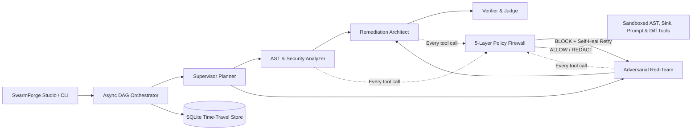

# SwarmForge

**Autonomous Multi-Agent DAG Orchestrator, 5-Layer Tool Policy Firewall, and Time-Travel Eval Studio.**

[](.github/workflows/ci.yml)
[](pyproject.toml)
[](swarmforge/server.py)
[](LICENSE)

SwarmForge solves the hardest engineering failures in production AI agent systems: **silent tool hallucinations, prompt-injection escalation, leaked credentials in tool arguments, unbounded retry storms, and non-reproducible multi-agent runs**.

It runs **100% locally out of the box with zero API keys required** (powered by deterministic Python AST analysis, security sink scanning, dependency mapping, and grounded synthesis), while seamlessly supporting **Bring-Your-Own-Key (BYOK)** routing to **Google Gemini, OpenAI, Anthropic, or local Ollama** over the exact same orchestration graph and safety firewall.

---

## Architecture



---

## Key Capabilities

### 1. Parallel Multi-Agent DAG Orchestrator (`swarmforge/engine/orchestrator.py`)
- Compiles missions into typed DAGs across three selectable strategies: `council_judge` (parallel specialist council + verifier gate), `plan_execute`, and `single_shot`.
- Streams every thought, tool proposal, firewall intercept, self-heal trigger, and judge verdict over **Server-Sent Events (SSE)** in real time.

### 2. Deterministic 5-Layer Tool Policy Firewall (`swarmforge/firewall/policy.py`)
Every tool invocation from any agent must pass through `PolicyFirewall.evaluate()` before execution:
1. **Capability Scope RBAC**: Least-privilege per-role allowlists (`red_team` cannot write patches; destructive tools like `shell_exec` are denied).
2. **Secret & PII DLP Scanner**: Detects and redacts/blocks AWS keys, GitHub PATs, bearer tokens, private key blocks, API keys, and SSNs in tool payloads.
3. **Prompt-Injection & Tool-Poisoning Guard**: Blocks instruction overrides, data-exfiltration directives, hidden HTML override tags, and zero-width Unicode obfuscation.
4. **Filesystem & Command Sandbox Guard**: Blocks `..` path traversal, sensitive host credential paths, and RCE shell pipelines (`curl | sh`, `rm -rf`, encoded PowerShell).
5. **Loop & Budget Circuit Breaker**: Halts repeated identical `(role, tool, args)` loops, hop explosions, and USD cost overruns.

When a specialist node is intercepted in `strict` mode, the orchestrator records the violation, transitions the node into **Self-Heal (`retrying`)**, and feeds the guardrail context back so the agent autonomously recovers with a compliant tool call.

### 3. Time-Travel Replay, Checkpoint Forking & Run Diff (`swarmforge/storage/db.py`)
- Every run and event step persists a complete **Blackboard State Snapshot** in SQLite.
- Scrub forward/backward step-by-step in the **Time-Travel & Diff** tab, **fork a run from any step `seq`** with a different strategy or policy mode, and compare two runs side-by-side (`score`, `tokens`, `firewall catches`, `finding coverage`, and `node latency` deltas).

### 4. Automated Eval Arena (`swarmforge/evals/suite.py`)
Benchmarks all 4 built-in missions across `single_shot`, `plan_execute`, and `council_judge`.

Latest verified strict-policy benchmark run (`swarmforge eval --policy strict --strict`):

| Strategy | Pass Rate | Avg Judge Score | Avg Finding Recall | Policy Compliance | Firewall Catches | Self-Heals |
|---|---:|---:|---:|---:|---:|---:|
| `council_judge` | **100.0%** | **100.0** | **100.0%** | **100.0%** | 4 | 4 |
| `plan_execute` | 75.0% | 77.8 | 59.5% | 100.0% | 0 | 0 |
| `single_shot` | 0.0% | 72.8 | 59.5% | 100.0% | 0 | 0 |

### 5. Real Sandboxed Tool Suite (`swarmforge/tools/registry.py`)
- `workspace_inventory` — file & LOC inventory across repositories or pasted specs
- `ast_complexity_scan` — Python `ast` parser measuring cyclomatic complexity hotspots and unbounded `while True` loops
- `secret_and_sink_audit` — AST & DLP detection for `eval()`, `pickle.load(s)`, `subprocess(..., shell=True)`, SQL f-string interpolation, retry storms, and credential leaks
- `dependency_graph_mapper` — internal & external module import topology
- `prompt_surface_auditor` — unescaped system prompt interpolation, injection payloads, and over-privileged MCP tool manifests
- `patch_synthesizer` — unified diff (`difflib`) remediation generator
- `schema_and_budget_verifier` — rubric scoring and SLA assertion checks

---

## Quickstart

### 1-Click Studio Website (Operate for Everyone)

Anyone can run and operate the full Web Studio instantly:

- **Windows**: Double-click `start_website.bat` or run:
  ```bash
  python run_studio.py
  ```
- **macOS / Linux**:
  ```bash
  chmod +x start_website.sh
  ./start_website.sh
  ```
- **Using SwarmForge CLI**:
  ```bash
  swarmforge serve --host 0.0.0.0 --port 8765
  ```

This starts the server on `0.0.0.0:8765`, automatically opens your browser at **http://localhost:8765**, and prints your local LAN address so **anyone on your network can access and operate it**.

Open **http://127.0.0.1:8765** to operate:
- **Orchestrator** — interactive animated SVG DAG, live SSE stream, node inspector, findings, colored unified diffs, and `.md` export
- **Time-Travel & Diff** — step scrubber, blackboard state snapshots, checkpoint forking, and side-by-side run comparison
- **Policy Firewall Lab** — instant guardrail payload tester & RBAC capability matrix
- **Eval Arena** — 1-click 12-run benchmark matrix with downloadable JSON reports

### Docker & Docker Compose (Zero-Config Host)

```bash
docker compose up --build
```
Access the studio at `http://localhost:8765`.

### Optional Live LLM Providers (BYOK)

Copy `.env.example` to `.env` or enter a session key in the Studio UI to enable live synthesis with:
- `GEMINI_API_KEY` (Google Gemini)
- `OPENAI_API_KEY` (OpenAI)
- `ANTHROPIC_API_KEY` (Anthropic)
- `OLLAMA_BASE_URL` (local Ollama server)

---

## REST & Streaming API

| Method & Path | Description |
|---|---|
| `GET /api/health` | Health status and configured provider availability |
| `GET /api/missions` | Mission blueprints and least-privilege RBAC matrix |
| `POST /api/runs` | Execute a mission and return the complete `RunRecord` |
| `POST /api/runs/stream` | Execute a mission with real-time Server-Sent Events (SSE) |
| `GET /api/runs/{run_id}/events` | Retrieve full or `up_to_seq` checkpoint timeline |
| `POST /api/runs/{run_id}/fork` | Fork a run from checkpoint `from_seq` with policy/strategy overrides |
| `GET /api/runs/diff/{a}/{b}` | Compute metric, node, and finding deltas between two runs |
| `POST /api/firewall/test` | Evaluate arbitrary `(role, tool, args)` against the 5-layer firewall |
| `POST /api/evals/run` | Execute the 12-run benchmark matrix and persist leaderboard results |

---

## Development & Verification

```bash
# Run full unit & API test suite
python -m unittest discover -s tests -v

# Check frontend JavaScript syntax
node --check swarmforge/web/dag.js
node --check swarmforge/web/views.js
node --check swarmforge/web/app.js

# PowerShell end-to-end verification script
./scripts/verify_all.ps1
```

CI runs automatically on every push and pull request via [`.github/workflows/ci.yml`](.github/workflows/ci.yml).
